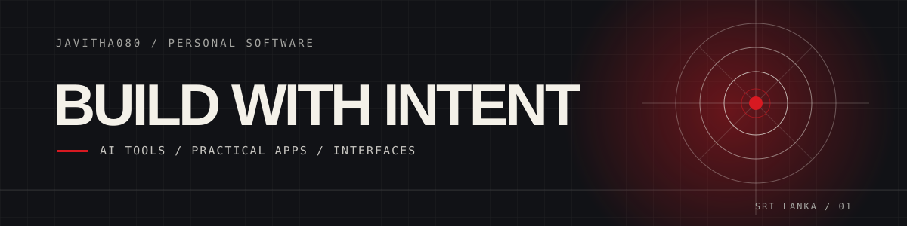

# Xen0n0

  

  <strong>SOFTWARE BUILDER / AI SYSTEMS / INTERFACES</strong> 
  <a href="https://github.com/Javitha080?tab=repositories">PROJECTS</a>
  &nbsp; / &nbsp;
  <a href="https://github.com/Javitha080">GITHUB PROFILE</a>

---

Hi, I'm **Xen0n0** (`@Javitha080`), a developer from Sri Lanka. I like taking curious ideas and shaping them into useful, well-considered software.

> **SO BE IT.** Build it, test it, make it useful.

## Selected work

### [AI Guru](https://github.com/Javitha080/AI-Guru)

A local-first AI learning workspace combining tutoring, exam practice, and on-device study monitoring.

`Python` / `Next.js` / `AI`

### [SimpleHMS](https://github.com/Javitha080/SimpleHMS)

A Windows desktop app for small clinics, covering patient records, appointments, billing, PDF receipts, and email.

`C#` / `.NET 9` / `SQL Server`

### [LMArenaBridge-Plus](https://github.com/Javitha080/LMArenaBridge-Plus)

A maintained fork that exposes LMArena through an OpenAI-compatible API, with a live model catalog, hardened auth, and CI.

`Python` / `FastAPI` / `APIs`

## Tools I use

Python / TypeScript / C# / Kotlin / React / SQL Server

## Currently exploring

Privacy-first AI, agent workflows, and practical learning tools that respect the people using them.

## Open to

Thoughtful collaborations and interesting problems. If you have an idea or question, open an issue on one of the projects above.

  WEST NAHIRA, SRI LANKA / BUILDING IN PUBLIC / SO BE IT.

